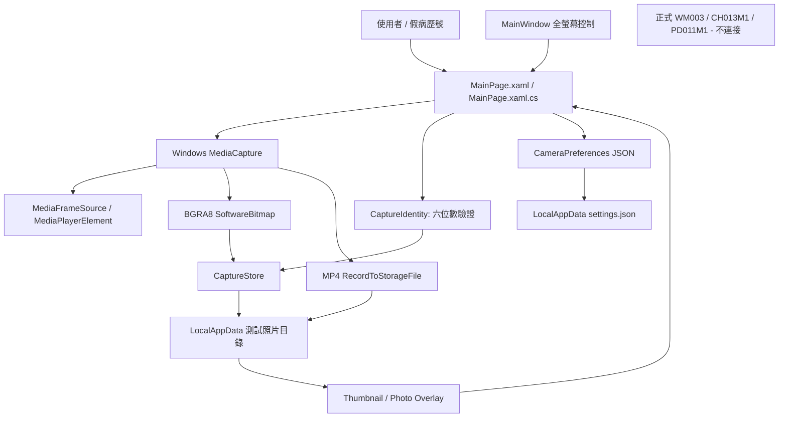
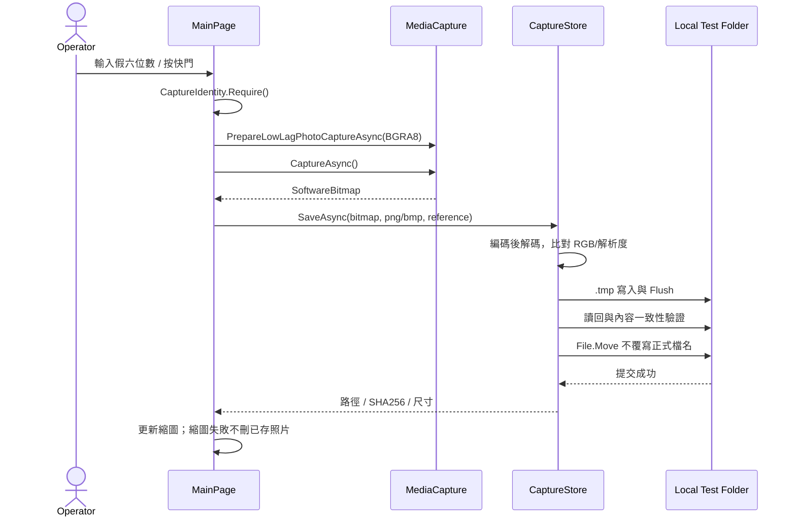

# Clinic Camera Capture — ARCHITECTURE.md

**範圍：** Windows 原生相機 UI + 使用者自訂路徑存檔（MVP v0.4.1；HIS 病歷索引仍不連接）。

詳見 [SPEC.md](SPEC.md) 及 [DESIGN.md](DESIGN.md)。

## 1. 核心架構



核心原則：**與 HIS 沒有連線**。原 HIS 的 DBF、CDX、FPT、圖片與索引在本專案不是可寫入或可讀取的資料來源。

## 2. 程式模組

| 檔案 | 現有責任 |
|---|---|
| `App.xaml[.cs]` | WinUI 啟動與視窗建立 |
| `MainWindow.xaml[.cs]` | 設定大小、`FullScreen` / `Overlapped` Presenter |
| `MainPage.xaml` | 頂端輸入欄、相機預覽、右側快門、左側設定抽屜、右下縮圖、照片 Overlay |
| `MainPage.xaml.cs` | 裝置枚舉、相機初始化、按鍵、拍照、錄影、模式與畫面狀態；由 `SemaphoreSlim` 序列化相機操作 |
| `CameraPreferences.cs` | 讀寫 UI 設定 JSON 與 OutputFolderPolicy 路徑格式正規化（不限制 Windows 資料夾位置、不儲存病歷號） |
| `CaptureIdentity.cs` | 1–6 位 ASCII 數字標準化為六位、照片 01–99 命名與錄影命名 |
| `CaptureStore.cs` | PNG/BMP 校驗、同磁碟暫存/驗證、跨副檔名 01–99 流水號，使用本機 mutex 避免競爭及覆寫 |
| `PhotoBatch.cs` | 本次 App 執行期間，以標準化六位號碼隔離同病歷號照片清單 |
| `tests/CaptureStore.Smoke` | 合成影像、流水號占用、99 上限、批次分組與路徑驗證回歸測試 |
| `AGENTS.md` | 正式 HIS 不能讀寫的工程作業限制 |

目前 `MainPage.xaml.cs` 同時承擔 UI 與攝影機 orchestrator，這是 MVP 的簡化實作；未來功能增加才拆分為 camera service、recorder、view model，避免虛構目前不存在的分層。

## 3. 攝影機初始化與預覽

1. 用 `DeviceInformation.FindAllAsync(DeviceClass.VideoCapture)` 列舉 Windows 裝置。
2. 優先用已儲存的穩定 DeviceId；未設定時優先選名稱包含 `USB2.0 PC CAMERA` 的設備。
3. `MediaCapture.InitializeAsync` 使用指定 `VideoDeviceId`、`StreamingCaptureMode.Video`、`MemoryPreference.Cpu`、`SharingMode.ExclusiveControl`。
4. 選擇 Color `MediaFrameSource`；透過 `MediaSource.CreateFromMediaFrameSource` 預覽。
5. 設定抽屜可查看並嘗試切換 `SupportedFormats`。**來源預覽格式不保證等同照片拍攝格式**。
6. 連線、格式切換、拍照、錄影透過 `_cameraGate` 串行控制，停止時 Dispose 相機；中斷後必須再確認重連情境。

診間已知 Windows 10 Build 19045 有兩個 Microsoft UVC 裝置，使用者在較早 MVP 版本已成功預覽／拍照（640×480）。**v0.3 的全螢幕、快捷鍵、影片錄製仍需診間實測。**

## 4. 照片保存順序與正確性



- PNG 保存 RGB 像素無損；BMP 檢查 `BI_RGB` 未壓縮格式。來源已是 MJPEG 等有損訊號的情形無法反向復原。
- 照片檔名規則為 `000090_01.png` ... `000090_99.bmp`；同一資料夾同號碼跨圖片格式共享 01–99，已用序號不重複，滿額就拒絕。短病歷號左補零，禁止路徑注入。
- 預選首個空閒編號，利用同目錄暫存＋非覆寫 `File.Move` 提交；本機跨程序 Mutex 保護同病歷號的流水號競爭。
- 此流程**不包含** `CH013M1` 更新；不會產生或同步正式 HIS 的影像索引。
- 仍未做正式臨床等級的跨程序鎖定、意外斷電保證、外部備份或存取稽核。

## 5. MP4 錄影與 UI 狀態

- 在左側設定切換 `photo` / `video`；右側一個按鈕執行照片保存或 MP4 開始／停止。
- MP4 使用 `MediaEncodingProfile.CreateMp4(VideoEncodingQuality.Auto)`，`Audio=null` 禁錄音；**影片不是無損**。
- 開始錄影後鎖定六位參考號與設定切換；錄影中 REC 標記顯示。停止後檢查輸出檔是否存在且非零大小，**不代表已完整驗證可解碼**。
- 若初始化錄影失敗且產生空檔，刪除僅該新建空檔；非零部分錄影需保留供診斷。
- 異常退出導致 MP4 未 finalize、相機中途斷線，仍可能產生不能播放的檔案；正式臨床錄影功能必須額外處理。

## 6. 設定、快捷鍵與隱私

```text
%LOCALAPPDATA%\ClinicCameraCapture-MVP\
  settings.json          # CameraId / Format / Shortcut / Mode / FullScreen / OutputFolder
  captures\              # 測試 PNG、BMP、MP4，嚴禁進 Git
```

- 快捷鍵 F8/F9/F10/F12 改為 `CameraRoot.KeyboardAccelerators`，由框架處理焦點子控制項；**僅前景有效**，不註冊 `RegisterHotKey`。
- F11 切換 FullScreen Presenter，Esc 關閉照片／設定或退出全螢幕。
- 真病歷號出現在影像檔名就是個人識別資料；MVP 只允許使用假號碼測試。
- 輸出路徑可透過 FolderPicker 或手動輸入設定；允許本機、UNC 共享、映射磁碟、磁碟根目錄、junction/symlink，以及使用者指定的 HIS 影像目錄。只做 Windows 路徑解析與權限試寫，不具 HIS 影像索引同步功能。批次相簿按本次執行期間正規化病歷號分組。
- 公開 GitHub 僅有原始碼、模板資源及合成測試，不放實際診間照片、影片、DBF 或憑證。

## 7. 建置、測試與發佈

```powershell
dotnet build ClinicCameraCapture.csproj -c Debug -p:Platform=x64
dotnet run --project tests/CaptureStore.Smoke/CaptureStore.Smoke.csproj -c Debug
```

針對 Win10 測試可使用 x64 self-contained 發佈**整個資料夾**（不是僅 EXE）；專案本身仍為非臨床 PoC。GitHub 不提交 `bin/`、`obj/`、發佈 ZIP 或測試影像。

## 8. 未來 HIS 整合界線（目前未實作）

原 HIS 透過 `CH013M1` 等 DBF 索引存放影像檔名。此新專案不應直接複製舊程式「先宣稱成功／未驗證再登錄」的風險行為。若日後獲得授權：

1. 先釐清 HIS 是否可讀取 PNG/BMP、`SPATH` 路徑與檔名限制。
2. 如只支援 JPG，無損母檔應另外保存，衍生 JPEG 僅供舊 HIS 顯示。
3. 僅在**去識別且隔離的 DBF/CDX 測試鏡像**驗證外部寫入及索引一致性。
4. 以受控 adapter 做「檔案已驗證 → 索引提交 → 失敗待補」與稽核／備份。
5. 正式資料還需患者身份確認、角色權限、刪改稽核、個資與醫療資料保存規範。

**本架構只定義目前 MVP 的責任，不表示已授權或已完成臨床 HIS 整合。**
