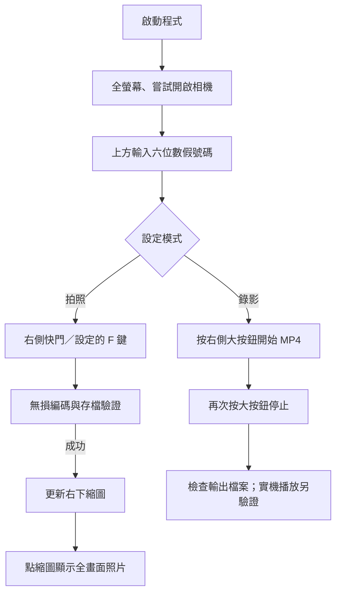

# Clinic Camera Capture — DESIGN.md

**版本：** v0.5（2026-10-23）

**視覺參考：** 使用者提供的 Windows「相機」App 截圖。

**目的：** 以內視鏡即時畫面為操作中心，避免舊工具繁雜的對話框及容易失焦的控制。

## 1. 使用情境與原則

- **預覽為主：** 使用者應直接看到大面積內視鏡即時影像，不需切換至另一個視窗。
- **核心動作唯一：** 右側只有一個主要快門；拍照／錄影模式在設定裡選。
- **最少干擾：** 設定抽屜藏在左上，保留常用病歷號欄位、錄影指示及右下照片預覽。
- **尊重來源：** 640×480（4:3）要顯示於 1920×1080（16:9）時以 `Uniform` 放大，左右留黑邊，不拉伸、不裁切、不假稱畫質提升。
- **避免身份錯置：** 使用者選配 PD011M1.dbf 後，輸入病歷號／身分證並失焦時唯讀比對 NUM、ID、NAME。查無有效資料時禁止拍照，未設定資料庫則保留獨立測試模式。

## 2. 1920×1080 相機畫面

```text
┌──────────────────────────── 全螢幕 (1920 × 1080) ───────────────────────────┐
│ [⚙]                  病歷號 [ 000123 ]                拍照模式／● REC       │
├──────────────────────────────────────────────────────────────┬──────────────┤
│                                                              │              │
│                                                              │              │
│           ┌─────────────────────────────────────┐            │              │
│           │           內視鏡 Live Preview       │            │   ◯ 快門     │
│           │              640 × 480              │            │              │
│           │         保留 4:3、放大不裁切        │            │              │
│           └─────────────────────────────────────┘            │              │
│                                                              │              │
│                        黑色背景                              │  [▧ 縮圖]   │
│                                                              │  檢視照片    │
└──────────────────────────────────────────────────────────────┴──────────────┘
```

目前 WinUI 3 以 Grid 疊層：全畫面 `MediaPlayerElement`、82px 頂端半透明列、112px 右側工具條、左側設定抽屜、照片全畫面遮罩，以及底部 InfoBar。Windows 本身的實際螢幕解析度決定滿版尺寸，不強行修改系統解析度或攝影機來源。

## 3. 各控制元件

| 位置 | 互動 | 說明 |
|---|---|---|
| 左上角齒輪 | 開啟／關閉設定抽屜 | 應不影響目前預覽 |
| 頂端中央 | 病歷號 1–6 位（失焦補零）、身分證字號輸入框、姓名唯讀框 | 設定 PD011M1 後可用 NUM／ID 雙向查詢，姓名不可編輯；資料未確認不得拍照 |
| 頂端右側 | 顯示拍照／錄影及 REC | MP4 錄影中高對比紅色 REC |
| 中央 | 即時預覽 | 採 4:3 比例保持完整的 640×480 來源影格 |
| 右側大圓按鈕 | 拍照／開始或停止錄影 | 依設定中的模式決定；錄影紅色、停止方形 |
| 右下角縮圖 | 目前病歷號的本次最後一張照片 | 點擊開批次相簿，可用上一張／下一張按鈕及 ←／→ 鍵切換 |
| 大圖右上方 | 返回相機／Esc | 關閉大圖，不刪除圖片 |
| 左下角訊息 | 成功／失敗／警告 | 不能在存檔失敗時顯示假成功 |

照片拍攝後需等到 `CaptureStore` 確認檔案已寫入才更新縮圖，避免誤導使用者。

## 4. 設定抽屜規格

左側約 455px 寬，深色半透明遮罩之上開啟，採垂直可捲動佈局：

| 設定 | 預設值 | 狀態 |
|---|---|---|
| 影像裝置 | 記住的 DeviceId，否則優先 `USB2.0 PC CAMERA` | 可重新搜尋／連線／停止 |
| 拍照／錄影 | 拍照 | 右側主按鈕依模式改變 |
| 照片格式 | PNG | 可切換 BMP；都保持 RGB 像素無損 |
| 拍照快捷鍵 | F9 | F8、F9、F10、F12（**只有前景**） |
| 啟動時全螢幕 | 開啟 | F11 手動切換，Esc 返回 |
| 來源格式 | 驅動支援的 Subtype／FPS／解析度 | 可切換預覽格式、複製清單 |
| 自訂儲存資料夾 | 預設 MVP LocalAppData | 可瀏覽或輸入 Windows 可用路徑；需具寫入權限，放入 HIS 資料夾也不會自動更新影像索引 |
| HIS 患者資料 | 未指定（測試模式） | 瀏覽 PD011M1.dbf、記憶路徑；病歷號失焦查 NUM，身分證失焦查 ID，帶入 NAME／ID／NUM |

`CameraPreferences.cs` 保存非病患 UI 偏好，**不保存病歷號**。

## 5. 操作動線



錄影中禁止切換病歷參考號／操作模式。設置畫面或大圖開啟時，拍照快捷鍵不應繞過按鈕禁用條件。

## 6. 鍵盤操作

- `F8/F9/F10/F12`：改用 WinUI `KeyboardAccelerator`，預設 F9，**只在程式前景**且條件允許時拍照；不攔截 Windows 其他程式，診間仍須驗證。
- `F11`：切換全螢幕；`Esc`：照片大圖 → 設定 → 一般視窗；照片大圖開啟時 `←`／`→` 依序切換同病歷號照片；右側 `× 關閉` 或 `Alt+F4` 結束 App。
- 當照片／設定遮罩顯示、輸入號碼無效、正在儲存或錄影中，不啟動拍照快捷鍵。
- 真實診間 Windows 10 的鍵盤焦點路由（尤其病歷號輸入框有焦點時）**仍須手動測試**。

## 7. 例外與風險對應

| 情境 | 畫面預期 |
|---|---|
| 相機不存在／被占用 | 清楚顯示錯誤，設定可重新搜尋 |
| 六位數識別未完成 | 文字警示與禁用主按鈕 |
| PNG/BMP 儲存失敗 | Error 狀態，不更新縮圖 |
| 圖檔保存成功但縮圖失敗 | Warning；仍保留已提交的檔案 |
| 錄影中 | REC 指示與停止按鈕 |
| 無法完成 MP4 | 顯示錯誤，不把檔案長度當作可播放的充分證明 |
| 裝置重插／斷線 | 釋放資源後可手動重連，仍須測試 |

## 8. 未完成的 UX／臨床要求

- 影片預覽播放器、跨次執行的完整歷史照片列表、刪除／還原、重新命名、拍照內容確認。
- 正式患者身份比對、切換病患時的二次確認、同步 `CH013M1` 的可追蹤狀態。
- 臨床病患隱私、角色權限、保存政策、備份及稽核。
- 本版 **v0.4 UI 尚未在實體擷取卡上完整驗證**；目前只確認較早 v0.1 的現場預覽／拍照成功。

**此設計文件描述當前 MVP 的 UI 與其測試限制，不表示已可使用真實病患影像。**
